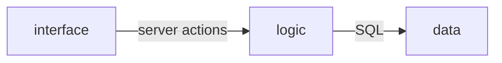

# Architecture — Personal Task Tracker

Level: **lite**. One project and one process (a Next.js app), described here by responsibility in three
parts: the interface, the logic and the data. Dependencies point one way.

| Component | Responsibility | May depend on |
|---|---|---|
| interface | Page, add form, task list and its empty / loading / error states, controls | logic |
| logic | One server process on 127.0.0.1, input validation, task rules, server actions, health route | data |
| data | Task table, migrations, the only connection to the SQLite file | nothing |

## Boundary rules

- Components receive data as props. The only components that touch server code are the task list (an async
  server component that reads the list) and the forms' server actions. This single exception is the
  blueprint's own; in the table above it is the interface asking the logic for the list.
- Only one file opens a database connection; everything else receives a database handle or asks for it.
- Queries live in one module. No component, route handler or action builds a query inline.
- Input is validated at the edge: every action parses its input before touching any query.
- Process environment is read in one place only (plus the migration tool, a standalone tool). The one variable,
  `DATABASE_PATH`, is optional and defaults to `data/tasks.db`.
- The server must never listen on anything but `127.0.0.1` (ADR-0003).
- Migrations run only by an explicit command, never when the app boots. Generated migration files are
  committed and never edited by hand; the schema is code and a migration is generated from it.

## Stack (choices and reasons)

| Layer | Choice | Why, and what was rejected |
|---|---|---|
| Language / runtime | TypeScript on Node.js 24 LTS | One language end to end. Rejected: Python/Flask (a second ecosystem). See ADR-0001 |
| Framework | Next.js (App Router) with React | Page and server code in one project and one process. Rejected: a Vite SPA plus a separate API. See ADR-0001 |
| Styling | Tailwind CSS with CSS custom-property tokens | No class naming; tokens are portable. Rejected: CSS-in-JS (runtime cost, server-rendering friction) |
| Components | Native HTML elements styled with the tokens | The app needs a text input and three buttons. Rejected: shadcn/Radix (extra dependencies and an init step) |
| Database | SQLite file `data/tasks.db` | No server to run; one file the owner can copy. See ADR-0002 |
| Data access | Drizzle ORM with the synchronous `better-sqlite3` driver | Schema is code, migrations are generated. Rejected: Prisma (heavier for one table). See ADR-0002 |
| Validation | zod, schemas in one module | Applied at the action boundary |
| Package manager, lint, tests | pnpm, Biome, Vitest (unit and integration), Playwright (end to end) | One tool replaces ESLint plus Prettier; integration tests use real SQLite files |
| Auth, background work, payments, file storage, email, hosting | Not applicable | Out of scope (non-goals) |

Pinned versions and where they were verified: EV-001, EV-002.

## Data model

One entity, one table, no relationships.

**Task** — created open, may be completed and reopened any number of times, deleted once.

| Field | Type | Notes |
|---|---|---|
| `id` | text, primary key | UUID generated in code |
| `title` | text, not null | Trimmed, 1 to 200 characters, enforced at the action boundary |
| `is_done` | boolean, not null, default false | |
| `created_at` | integer (ms epoch), not null | Drives ordering |
| `updated_at` | integer (ms epoch), not null | Set on every change |
| `completed_at` | integer (ms epoch), nullable | Set when marked done, cleared when reopened |
| `deleted_at` | integer (ms epoch), nullable | Non-null means deleted; every read filters it out (ADR-0005, ADD-001) |

Index: `idx_tasks_deleted_at_created_at` on (`deleted_at`, `created_at`), because the list filters on
`deleted_at` and sorts on `created_at`. There is no `user_id`: single user by decision (ADR-0003). There is
no seed data; a fresh database is empty and the page shows its empty state.

List order: open tasks before done tasks, newest first, with the insertion order as a tie-break.

## API

There is no HTTP API for the owner's data (ADR-0004). The page talks to the server through server actions:

| Action | Input | Behavior |
|---|---|---|
| add task | form field `title` | Trim; 1 to 200 characters. Empty or non-text: "Enter a task."; over 200: "Keep it under 200 characters." On success it inserts one open task and refreshes the list. On failure it writes nothing and returns the error with the submitted text so the field keeps it |
| toggle task | `id` (UUID), `isDone` ("true" or "false") | Sets the explicit target state, sets `completed_at` to now when done and clears it when reopened. An invalid or unknown or deleted id changes nothing. Repeating it is harmless |
| delete task | `id` (UUID) | Marks a live task deleted. An invalid id or an already deleted task changes nothing |

One route exists for checks: `GET /api/health` returns 200 and `{"status":"ok"}`. It proves the process is
up; it does not check the database. It is used only by the loopback check script (ADD-004).

Conventions: no pagination (the list is unbounded in v1), no rate limits (loopback only), no response envelope.

## Rendering

The list page is rendered per request, never frozen at build time. The blueprint's mechanism: the list is an
async server component that awaits `connection()` inside `<Suspense>`, and the page must not declare
`dynamic`, `"use cache"` or `revalidate` exports. After each action the server revalidates `/`. All state is
server state in SQLite; the only client state is the add form's result.

States: loading shows "Loading tasks..."; empty shows "No tasks yet. Add your first one above."; an error
boundary shows "Something went wrong", "The task list could not be loaded." and a "Try again" button.

## Appearance

Ten color tokens defined once (primary, primary text, background, surface, border, strong border, text,
muted text, destructive, success), light by default and dark under `prefers-color-scheme: dark`, with no manual
toggle (ADD-002). System sans font, no network fonts. 4px spacing scale, `rounded-md` controls, `rounded-lg`
rows, flat with no shadows, one centered column at most `max-w-xl`, mobile-first. No motion beyond color
transitions, which collapse under `prefers-reduced-motion: reduce`. A new component belongs only if it is a native
element styled with these tokens; anything needing a new color, a shadow or an icon set does not belong in v1.

Accessibility baseline (ADD-003, QA-003 to QA-005): `lang="en"`, one `main`, one `h1`, a skip link first, a real
label on the input, error text with `role="alert"`, buttons with visible text that point at their task title, done
state shown by text and line-through (not by color alone), a visible 2px focus outline, buttons at least
`min-h-10`.

## Security posture

No secrets exist. React escapes task titles (`dangerouslySetInnerHTML` is forbidden), Drizzle parameterizes every
query (the one raw fragment is the constant `rowid desc`), and Next.js server actions enforce same-origin
checks. The accepted residual risk: any process or user on the same computer can open `http://127.0.0.1:3000`.
`.env`, `data/` and any database file are never committed.

## How it is checked

Static types and lint across the repo; Vitest unit and integration tests, where integration tests use real, freshly
migrated SQLite files (no mocks); Playwright end-to-end tests against a separate database (`data/e2e.db`) on
port 3100; and the loopback script against the built server. Not tested on purpose: the error boundary's
rendering, the loading fallback, anything beyond the body background for light/dark, browsers other than Chromium.

## Decisions

- ADR-0001 — TypeScript on Node.js with Next.js as one project and one process.
- ADR-0002 — SQLite file with Drizzle and the synchronous better-sqlite3 driver.
- ADR-0003 — Loopback-only server and no authentication.
- ADR-0004 — Server actions instead of an HTTP API.
- ADR-0005 — Soft delete.

Smaller decisions kept here, with no ADR: native HTML elements instead of a component library; light and dark
from the system setting with no toggle (ADD-002); Biome pinned to 2.5.15 and TypeScript to 6.0.x because the
track's compatibility fixes were exercised on those lines (reverse once newer versions are shown to work);
migrations by explicit command (never reversed for this project).

## Risks

| Risk | Likelihood | Impact | Early signal | Mitigation |
|---|---|---|---|---|
| The blueprint's setup and gates were never executed by the session that wrote it; a scaffold flag, the Biome and scaffold combination, or the Next 16 build may fail on first run. Also unverified: whether better-sqlite3 needs `serverExternalPackages` in Next, and the scaffold's own Tailwind integration package version | M | M | A non-zero exit on the first setup or build | Each failure message is the spec for the fix; keep the pins; stop and report after three failures on the same command |
| Other people on the same Wi-Fi reach the app (no login) | L | H | `ss` shows a wildcard listener on port 3000 | `-H 127.0.0.1` in the dev and start scripts; the loopback script fails the gate |
| Tasks lost, because they live in one file | M | M | `data/tasks.db` missing or empty | Backup by copying the file; `data/` is git-ignored; accepted for a prototype |
| The page is frozen at build time (empty list forever) because Next prerenders it | M | H | The end-to-end list test fails when rows are added after the server starts | `connection()` inside `<Suspense>`; no `dynamic`, `"use cache"` or `revalidate` exports |
| The owner stops using it because starting it by hand is a chore | M | M | No tasks created for several days | One command to start; auto-start is a non-goal with a revisit trigger |
| Playwright's Chromium cannot start for missing system libraries (the owner's OS is Fedora) | M | L | "error while loading shared libraries" | Install the browser dependencies separately (needs sudo) |
| Scope creep: reminders, tags, editing, accounts | M | M | A change touching something outside the data model above | The non-goals table and its revisit triggers |
