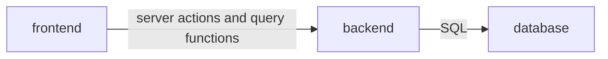

# Architecture — Personal Task Tracker

Level: **lite**. One process, one table, three components and one rule: dependencies point one way.

The chosen framework (Next.js) keeps the page and the server code in one project and one process. The
components below are therefore described by responsibility, not by deployment unit.

| Component | Responsibility | May depend on |
|---|---|---|
| frontend (Interface) | Page, add form, task list and its empty, loading and error states, styling | backend |
| backend (Task logic) | Input validation, task rules, server actions, query functions; the process that listens on `127.0.0.1` only | database |
| database (Data store) | Task table definition, the only database connection, migrations, the SQLite file | nothing |

Mapping used for this conversion: the pages, components and styles are the frontend; the server actions, the
validation rules and the task query functions are the backend; the table definition, the connection and the
migrations are the database. The task list is a server-rendered component that reads through the backend's
query functions, never through the database component directly.

## Boundary rules

- Interface components never import data-access code; they receive data as props. Only the server-rendered
  task list and the server actions call the task query functions.
- Only the data store opens a database connection; everything else receives a connection or asks for the shared one.
- Queries live only in the task query module: no component, route handler or action builds a query inline.
- Process environment is read in one place only (plus the migration tool's own config).
- The server never listens on anything but `127.0.0.1`, in development and in production (QA-001, ADR-0004).

## Data model

One entity, no relationships.

**Task** — one thing the owner wants to do. Created open, may be completed and reopened any number of times,
soft-deleted once.

| Field | Type | Notes |
|---|---|---|
| `id` | text, primary key | UUID generated in code |
| `title` | text, not null | Trimmed, 1–200 characters; enforced at the action boundary |
| `is_done` | boolean, not null, default false | |
| `created_at` | timestamp (ms), not null | Drives ordering |
| `updated_at` | timestamp (ms), not null | Set on every change |
| `completed_at` | timestamp (ms), nullable | Set when marked done, cleared when reopened |
| `deleted_at` | timestamp (ms), nullable | Non-null means soft-deleted; every read filters it out |

One index on (`deleted_at`, `created_at`), because the list query filters on the first and sorts on the second.
There is no `user_id`: single user by decision (ADR-0004). The list is ordered open first, then newest first,
with insertion order breaking ties. Migrations are generated from the schema, committed, and applied by an
explicit command, never on app start. There is no seed data; a fresh database is empty and shows the empty state.

## API

There is no HTTP API for the owner's data (ADR-0002). The page talks to the server through three server actions:

| Action | Input | Behavior |
|---|---|---|
| add task | `title` | Trim; 1–200 characters. Empty or non-text: `Enter a task.`; over 200: `Keep it under 200 characters.`. On success inserts an open task and refreshes the list; on failure writes nothing and returns the typed text so the field keeps it. |
| toggle task | `id`, target state | Sets done or not done explicitly, so a repeated submit is harmless; sets or clears `completed_at`. An invalid or deleted id changes nothing. |
| delete task | `id` | Sets `deleted_at` if the task is live. An invalid or already deleted id changes nothing. |

One route exists besides the page: `GET /api/health`, returning `{"status":"ok"}`. It proves the server process
is up (it does not check the database) and is used to check that the server answers on the loopback address.
No pagination, rate limits or error codes: single local user, unbounded list in v1.

## Interface rules

- One page (`/`) rendered **per request**, never prerendered, so the list is never frozen at build time when
  the database may not exist. After each action the page is refreshed.
- Only state is server state; the only client state is the add form's result. No global store, no client data fetching.
- States: loading ("Loading tasks..."), empty ("No tasks yet. Add your first one above."), error (a route
  error boundary with a "Try again" button).
- Native HTML elements styled with design tokens; no component library. Flat, one centered column, one accent
  color, no icons or shadows, system font stack, no network fonts. Light and dark follow the OS (CON-004).
  Transitions collapse under reduced-motion preferences.
- Accessibility baseline (QA-002, QA-003): one `main`, one `h1`, a skip link first, a real label on the input,
  the error shown as text, done state shown by text and strike-through and not by color alone, task buttons
  tied to their task title for screen readers, focus ring visible.
- Task titles are rendered as text, never as HTML.

## Security

No secrets exist. Titles are validated with a length cap and ids are checked as UUIDs before any query; every
query is parameterized; the framework's same-origin check protects the actions. The trust boundary is the
loopback binding (CON-002); the accepted residual risk is that any process or user on the same computer can
open the app. Dependency audits are run by hand when updating dependencies.

## Risks

| Risk | Likelihood | Impact | Mitigation |
|---|---|---|---|
| Other people on the same network reach the app (no login) | Low | High | Loopback-only binding and a start-up check of the listening sockets (QA-001) |
| Tasks lost, because they live in one file | Medium | Medium | The owner copies the file as a backup; accepted for a prototype |
| The page is frozen at build time and shows an empty list forever | Medium | High | Per-request rendering (Interface rules); a test that seeds rows after the server starts |
| The owner stops using it because starting it by hand is a chore | Medium | Medium | One start command; auto-start is a non-goal with a revisit trigger (see the brief) |
| Scope creep toward reminders, tags, editing or accounts | Medium | Medium | The non-goals in `blueprint.yaml` and their revisit triggers |

## Decisions

- ADR-0001 — TypeScript on Node.js with Next.js.
- ADR-0002 — Server actions, no REST API.
- ADR-0003 — SQLite file through Drizzle and `better-sqlite3`.
- ADR-0004 — Loopback-only access, no authentication, no `user_id`.
- ADR-0005 — Soft delete.

## Stack

| Layer | Choice |
|---|---|
| Language / runtime | TypeScript on Node.js 24 LTS line |
| Framework | Next.js (App Router) with React |
| Styling | Tailwind CSS with CSS custom-property tokens |
| Database / access | SQLite file; Drizzle ORM with the synchronous `better-sqlite3` driver |
| Validation | zod |
| Quality tooling | Biome (lint and format), Vitest (unit and integration against real SQLite files), Playwright (end to end) |
| Package manager | pnpm |

Exact versions and where they were checked are in the evidence files. The reasons for each choice are in the ADRs.
