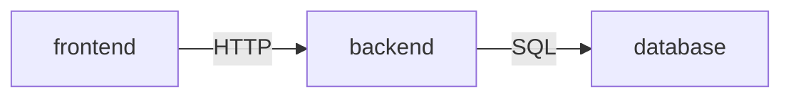

# Architecture — Todo App

Level: **lite**. Three components and one rule: dependencies point one way.

| Component | Responsibility | May depend on |
|---|---|---|
| frontend | Renders the list and form; talks HTTP only | backend |
| backend | Validates input, applies task rules, exposes the API | database |
| database | Durable storage on the owner's machine | nothing |

## Boundary rules (enforced by architecture tests, see ADR-0002)

- The frontend never imports backend or database code.
- Only the backend opens a database connection.

## Decisions

- ADR-0001 — SQLite as the storage engine.
- ADR-0002 — Architecture tests enforce the dependency direction.

## Stack

Deliberately not chosen here: the example is language-agnostic. A real blueprint names the
language and framework with a rationale and evidence for each choice.
